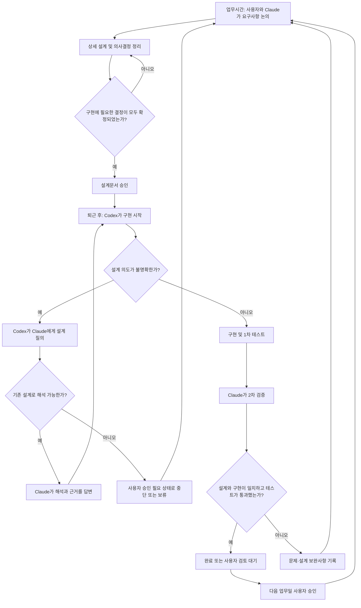
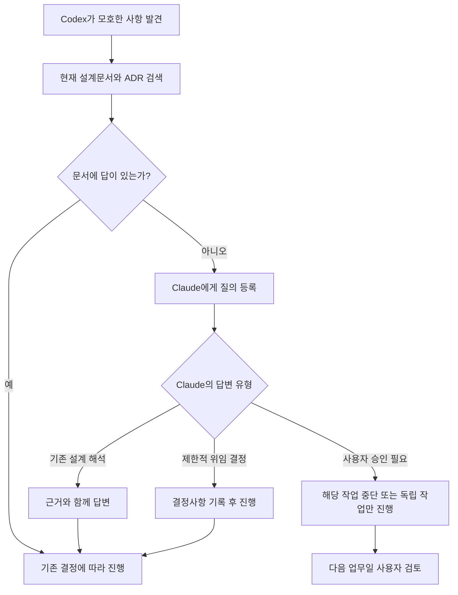

# Codex–Claude 협업 기반 야간 개발 운영 모델

## 1. 문서 목적

이 문서는 Codex와 Claude를 함께 사용하여, 업무시간에는 설계와 의사결정을 진행하고 퇴근 후에는 구현과 검증을 수행하는 시스템 개발 운영 방식을 정의한다.

이 문서의 목적은 두 에이전트가 각자의 역할을 혼동하지 않고, 사용자가 업무시간 외에도 안전하게 개발을 진행할 수 있도록 하는 것이다. Claude는 설계 의도를 관리하고 검증하며, Codex는 승인된 설계를 코드로 구현한다. 사용자는 중요한 의사결정과 최종 승인을 담당한다.

이 문서는 Claude에게 전달하여 운영 모델과 역할 분담을 재검토하기 위한 기준 문서로 사용한다.

## 2. 핵심 운영 원칙

이 운영 모델은 개발을 즉시 구현하는 방식이 아니라, 설계를 먼저 확정한 뒤 구현하는 방식이다.

업무시간에는 Claude와 사용자가 요구사항, 시스템 구조, 예외 상황, 데이터 흐름, 테스트 조건을 충분히 검토한다. 구현에 영향을 주는 의사결정이 확정되면 그 결과를 설계문서에 기록한다.

퇴근 후에는 Codex가 승인된 설계문서를 기준으로 구현과 1차 테스트를 수행한다. 구현 중 설계 의도가 불분명하면 Codex는 임의로 추측하지 않고 Claude에게 질의한다. Claude는 기존 설계에 근거한 해석은 답변할 수 있지만, 새로운 중요 의사결정을 사용자를 대신하여 확정해서는 안 된다.

Codex의 구현이 끝나면 Claude가 설계자 관점에서 2차 검증을 수행한다. 이 검증은 단순한 코드 리뷰가 아니라 설계 적합성, 기능 동작, 예외 처리, 회귀 가능성을 확인하는 절차다.

사용자는 다음 업무일에 결과보고서와 미결정 항목을 검토한다. 설계 보완이 필요하면 Claude와 다시 설계를 수정하고, 다음 야간 작업을 위한 새로운 승인 상태를 만든다.

## 3. 역할 정의

### 사용자: 의사결정자 및 최종 승인자

사용자는 비즈니스 요구사항과 우선순위를 결정하고, 중요한 설계 선택을 승인한다. 다음과 같은 사항은 사용자의 승인 없이 확정하지 않는다.

- 데이터 모델이나 데이터 보존 정책의 변경
- 인증·권한 정책의 변경
- 외부 API 계약의 변경
- 기존 기능과의 호환성을 깨는 변경
- 운영 배포, 데이터 마이그레이션, 비용 발생 작업
- 제품 동작이나 사용자 경험의 핵심 변경

### Claude: 설계자·질의 응답자·검증자

Claude는 업무시간에 사용자의 요구사항을 상세 설계로 발전시키고, 의사결정 항목을 드러내며, 설계문서를 관리한다.

퇴근 후에는 Codex가 남긴 설계 질의를 검토한다. 기존 설계에서 해석 가능한 질문에는 근거를 설명하고 답변한다. 기존 설계에 결정이 없거나 여러 선택지가 있는 경우에는 임의로 확정하지 않고 사용자 승인 필요 상태로 표시한다.

Codex의 구현이 완료되면 Claude는 변경사항과 테스트 결과를 설계문서와 대조한다. 코드가 실행된다는 사실만으로 완료 처리하지 않고, 설계 의도대로 구현되었는지와 요구사항이 실제 동작으로 검증되는지를 확인한다.

### Codex: 구현자·1차 검증자

Codex는 승인된 설계 범위 안에서 코드를 작성하고 수정한다. 구현 중 모호한 사항이 발견되면 먼저 기존 설계문서와 의사결정 기록을 검색한다. 문서에 답이 없으면 Claude에게 질의하고, 중요한 결정이 필요한 경우에는 해당 지점에서 작업을 중단하거나 독립적으로 진행 가능한 작업만 수행한다.

Codex는 구현 후 관련 테스트, 린트, 타입 검사, 빌드를 실행한다. 테스트 실패나 설계와 구현의 불일치를 숨기지 않고 결과보고서에 기록한다.

## 4. 전체 개발 흐름



이 흐름에서 중요한 점은 Claude가 설계 단계와 검증 단계에 모두 참여하지만, Codex가 구현 중인 코드를 동시에 수정하지 않는다는 것이다. 한 시점에 코드 수정 권한을 가진 주체는 Codex 하나로 제한한다.

## 5. 업무시간의 설계 절차

업무시간의 목표는 “대략적인 방향을 정하는 것”이 아니라, Codex가 야간에 별도의 추가 설명 없이 구현을 시작할 수 있을 정도로 설계를 구체화하는 것이다.

설계 대화에서는 기능의 목적과 범위를 먼저 확정하고, 기존 시스템과의 관계, 데이터 구조, 상태 변화, API 계약, 정상 흐름, 예외 흐름, 권한, 성능, 로깅, 테스트 기준을 검토한다.

설계가 완료되기 위해서는 구현에 영향을 주는 의사결정 항목이 모두 다음 중 하나로 분류되어야 한다.

1. 사용자가 명시적으로 확정한 결정
2. 프로젝트의 기존 규칙에 따라 이미 정해진 결정
3. 영향이 작고 되돌릴 수 있어 Claude에게 제한적으로 위임한 결정
4. 사용자 승인 없이는 구현을 진행하지 않을 미결정 항목

설계문서에는 미결정 항목을 숨기지 않는다. 미결정 항목이 야간 구현을 막는다면 해당 작업은 승인할 수 없는 상태로 둔다.

## 6. 야간 구현과 질의응답

Codex는 작업 시작 전에 승인된 설계문서, 현재 작업 범위, 관련 ADR, 이전 결과보고서를 읽는다. 이후 설계에 정의된 범위만 구현한다.

구현 중 질문이 생기면 다음 순서로 처리한다.



Claude의 야간 답변은 기존 설계를 해석하는 것과 새로운 설계를 결정하는 것을 구분해야 한다.

기존 설계에 이미 근거가 있으면 Claude는 Codex가 작업을 계속할 수 있도록 의도를 설명한다. 반대로 설계문서에 결정이 없고 여러 방안이 가능하면 Claude는 사용자를 대신해 확정하지 않는다. 이 경우 Codex는 질문이 해결될 때까지 해당 부분을 중단한다.

## 7. 질의 형식과 답변 규칙

Codex가 남기는 질의는 다음 정보를 포함해야 한다.

```markdown
# 설계 질의

- 질의 ID:
- 관련 작업:
- 관련 설계문서:
- 이해하지 못한 내용:
- 현재 가능한 선택지:
- 각 선택지의 영향:
- 결정하지 않으면 중단되는 이유:
- Codex의 임시 의견:
```

Claude의 답변은 다음 상태 중 하나를 명확히 선택해야 한다.

```text
clarified              기존 설계로 해석 가능하며 구현을 계속할 수 있음
limited-decision       영향이 작아 제한적으로 결정하고 기록한 뒤 진행 가능
decision-required      사용자 승인이 필요하므로 해당 부분은 진행하지 않음
blocked                안전성·데이터·권한 문제로 작업을 중단함
```

`clarified`는 설계 변경이 아니다. `limited-decision`은 새로운 결정이므로 반드시 결과보고서와 결정 기록에 남긴다. `decision-required`와 `blocked`는 Codex가 임의로 우회해서는 안 된다.

## 8. Claude의 2차 검증

Codex의 자체 테스트는 구현자가 수행하는 1차 검증이다. Claude의 검증은 설계자가 수행하는 2차 검증이며, 서로 목적이 다르다.

Claude는 다음 세 가지를 함께 대조한다.

```text
승인된 설계문서 ↔ 실제 코드 변경사항 ↔ 실행된 테스트 결과
```

검증 과정에서 Claude는 다음을 확인한다.

- 설계 요구사항이 모두 구현되었는가
- 설계에서 금지한 동작이 추가되지 않았는가
- 정상 흐름과 예외 흐름이 모두 동작하는가
- 데이터 저장과 상태 전이가 올바른가
- 권한과 보안 조건이 지켜지는가
- 기존 기능에 회귀가 발생하지 않았는가
- 테스트가 실제 요구사항을 검증하는가
- 설계와 코드가 다를 경우 어느 쪽을 수정해야 하는가

Claude의 검증 결과는 다음 중 하나로 종료한다.

```text
passed             설계와 구현이 일치하고 검증을 통과함
passed-with-notes  완료 가능하지만 다음 작업에서 확인할 참고사항이 있음
failed             구현 또는 테스트에 수정이 필요함
blocked            설계 또는 환경 문제로 검증을 완료할 수 없음
```

Claude는 테스트를 통과시키기 위해 설계를 임의로 완화해서는 안 된다. 코드가 설계와 다르면 설계를 바꿀지 코드를 바꿀지 사용자에게 명확히 제시해야 한다.

## 9. 야간 작업의 상태 관리

두 에이전트가 서로의 작업 상태를 오해하지 않도록 저장소에 작업 상태를 기록한다.

```text
planned             설계 작성 중
approved             사용자가 구현 승인
implementing        Codex가 구현 중
ready-for-review     Codex 구현 및 1차 테스트 완료
reviewing            Claude가 2차 검증 중
passed               검증 통과
passed-with-notes    참고사항과 함께 통과
failed               수정 필요
blocked              의사결정 또는 환경 문제로 중단
user-review         사용자 검토 대기
```

Claude는 `ready-for-review` 상태가 되기 전에는 최종 검증을 시작하지 않는다. Codex는 `approved` 상태가 아니면 야간 구현을 시작하지 않는다. `blocked` 상태는 임의로 `approved` 또는 `passed`로 바꾸지 않는다.

## 10. 권장 저장소 구조

```text
project/
├─ AGENTS.md
├─ CLAUDE.md
├─ docs/
│  ├─ requirements.md
│  ├─ architecture.md
│  ├─ testing-strategy.md
│  ├─ decisions/
│  │  ├─ ADR-001-*.md
│  │  └─ ADR-002-*.md
│  └─ design/
│     ├─ current-design.md
│     └─ revisions/
├─ work/
│  ├─ status.md
│  ├─ current-task.md
│  ├─ implementation-plan.md
│  ├─ queries/
│  │  └─ answered/
│  └─ handoff/
│     ├─ latest-report.md
│     └─ history/
├─ src/
├─ tests/
└─ scripts/
```

`current-design.md`는 이번 작업의 최종 설계 기준이다. `current-task.md`는 야간에 수행할 범위와 완료 조건이다. `status.md`는 현재 단계다. `queries/`는 야간 질의와 답변의 기록이다. `latest-report.md`는 다음 업무일에 사용자가 확인할 핵심 결과다.

## 11. 결과보고서 기준

Codex와 Claude는 대화창에만 결과를 남기지 않고 다음 형식으로 결과를 기록한다.

```markdown
# 개발 결과보고서

- 작업일:
- 작업 항목:
- 설계 버전:
- 구현 커밋:
- 최종 상태:

## 구현 내용

## 변경된 파일

## Codex 1차 테스트 결과

## Claude 2차 검증 결과

## 설계와 구현의 차이

## 발견한 문제

## 미해결 질의

## 사용자에게 필요한 의사결정

## 다음 작업 제안
```

다음 업무일에 사용자는 전체 로그를 다시 읽지 않고도 이 보고서만으로 전날의 개발 상태를 파악할 수 있어야 한다.

## 12. 안전장치

야간 자율 실행의 범위는 코드 작성과 테스트로 제한한다. 다음 작업은 사용자의 명시적 승인 없이는 실행하지 않는다.

- 운영 서버 배포
- 운영 데이터베이스 변경
- 데이터 삭제 또는 비가역적 마이그레이션
- 외부 메시지나 이메일 발송
- 결제 또는 비용 발생 작업
- 인증·권한 정책 변경
- 비밀정보의 신규 저장 또는 외부 전송

또한 Codex와 Claude는 동시에 같은 파일을 수정하지 않는다. Codex가 구현하는 동안 Claude는 설계 질의에 답하거나 읽기 전용 분석만 수행한다. Codex가 `ready-for-review` 상태를 기록한 후에만 Claude가 검증한다.

## 13. 최종 운영 모델

이 개발 환경의 최종 원칙은 다음과 같다.

> Claude는 설계의 완결성과 의도 보존을 책임지고, Codex는 승인된 설계를 코드와 테스트로 변환한다. 사용자는 중요한 의사결정과 최종 승인을 담당한다.

이 구조에서 야간 개발은 완전한 무제한 자율 개발이 아니다. 이미 승인된 설계를 실행하되, 불확실성이 발생하면 Claude가 기존 설계를 해석하고, 새로운 중요 의사결정이 필요할 경우 안전하게 중단하는 제한적 자율 개발이다.

따라서 시스템의 성공 기준은 “매일 밤 많은 코드를 생성하는 것”이 아니다. 다음 업무일에 사용자가 다음 네 가지를 명확하게 확인할 수 있는 것이 성공 기준이다.

1. 승인된 설계 중 어디까지 구현되었는가
2. 실제 동작 검증은 어떤 결과였는가
3. 설계와 구현이 어디에서 달라졌는가
4. 다음 작업을 위해 사용자가 결정해야 할 사항은 무엇인가

이 네 가지가 매일 명확하게 누적되면, Claude와 Codex는 하나의 개발팀처럼 작동하면서도 설계·구현·검증·승인의 책임이 서로 섞이지 않는 안정적인 프로젝트 운영 구조를 만들 수 있다.

