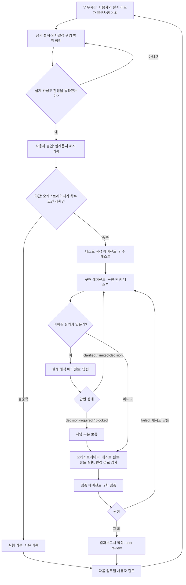

# 나의 Claude 개발 프로세스

> Claude 에이전트 여러 개로 역할을 나누어, 업무시간에는 사용자와 설계·의사결정을 진행하고 퇴근 후에는 구현과 검증을 수행하는 개발 프로세스다. Claude Code 기능에 관한 내용은 2026-11-26 기준 공식 문서로 확인했으며 근거는 부록 A에 정리했다. 이전에 검토한 Codex–Claude 협업 모델과의 차이는 부록 B에 정리했다.

## 1. 문서 목적

이 문서는 Claude 에이전트 여러 개로 역할을 나누어, 업무시간에는 사용자와 설계·의사결정을 진행하고 퇴근 후에는 구현과 검증을 수행하는 개발 프로세스를 정의한다.

이 프로세스는 모든 역할에 Claude를 쓴다. 서로 다른 도구를 쓰면 역할 경계가 저절로 생기지만, 같은 모델로 역할을 나누면 경계를 일부러 만들어야 한다. 경계는 실행 단위(프로세스), 컨텍스트, 권한의 세 가지로 만든다. 이 문서는 경계를 어떻게 나누는지와 무엇으로 강제하는지를 함께 정의한다.

## 2. 핵심 운영 원칙

1. **설계를 먼저 확정한 뒤 구현한다.**
2. **역할은 이름이 아니라 실행 단위로 나눈다.** 각 에이전트는 별도 프로세스와 별도 컨텍스트로 실행하고, 다른 에이전트의 대화를 이어받지 않는다. 에이전트 사이의 전달은 저장소에 남는 파일로만 한다.
3. **규칙은 문장이 아니라 장치로 강제한다.** "승인 전 구현 금지", "코드 수정 주체는 하나", "검증자는 코드를 고치지 않는다" 같은 규칙은 오케스트레이터의 확인, 권한 설정, 샌드박스, 훅, git 검사로 보장한다. 에이전트 지시문에 적은 규칙은 보조 수단이다.
4. **검증 근거는 진술이 아니라 실행 기록이다.** 테스트·린트·빌드 결과는 오케스트레이터가 직접 실행한 로그를 쓴다.
5. **새로운 중요 의사결정은 야간에 확정하지 않는다.** 야간 위임 결정은 업무시간에 작업별로 적어 둔 범위 안에서만 허용한다.
6. **야간 실행은 언제든 중단될 수 있다고 가정한다.** 단계마다 커밋과 상태 기록을 남겨, 다시 실행하면 중단 지점부터 이어 간다.

## 3. 역할 정의

| 역할 | 실체 | 쓰기 허용 범위 | 주 입력 | 주 산출물 |
|---|---|---|---|---|
| 사용자 | 사람 | 승인 파일, 최종 상태 | 결과보고서 | 승인, 의사결정 |
| 설계 리드 | 업무시간 대화형 Claude 세션 | `docs/**`, `work/current-task.md` | 사용자와의 대화 | 설계문서, ADR, 작업 정의 |
| 야간 오케스트레이터 | 스크립트 (LLM 아님) | `work/status.json`, `work/logs/**`, 보고서, 커밋 | 승인·상태 파일 | 단계 실행, 상태 전이, 검증 로그 |
| 테스트 작성 에이전트 | Claude (`test-author`) | `tests/acceptance/**` | 설계문서, 작업 정의 | 인수 테스트 |
| 구현 에이전트 | Claude (`implementer`) | `src/**`, `tests/unit/**`, `work/queries/open/**`, `work/handoff/impl-notes.md` | 설계문서, 작업 정의, 답변된 질의 | 코드, 단위 테스트, 질의 |
| 설계 해석 에이전트 | Claude (`design-interpreter`) | `work/queries/answered/**` | 질의, 설계문서, ADR, 코드(읽기) | 질의 답변 |
| 검증 에이전트 | Claude (`reviewer`) | `work/reviews/**` | 설계문서, diff, 테스트 로그 | 판정, 요구사항 추적표 |

### 사용자: 의사결정자 및 최종 승인자

사용자는 비즈니스 요구사항과 우선순위를 정하고, 중요한 설계 선택을 승인한다. 다음 사항은 사용자의 승인 없이 확정하지 않는다.

- 데이터 모델이나 데이터 보존 정책의 변경
- 인증·권한 정책의 변경
- 외부 API 계약의 변경
- 기존 기능과의 호환성을 깨는 변경
- 운영 배포, 데이터 마이그레이션, 비용 발생 작업
- 제품 동작이나 사용자 경험의 핵심 변경

다음도 사용자가 정한다.

- 작업별 위임 가능 범위 (`limited-decision`을 허용할 항목 목록)
- 야간 실행 1회의 시간·사용량 상한과 재시도 횟수
- 야간 에이전트에게 허용할 네트워크 접근 범위 (패키지 설치 등)

### 설계 리드: 업무시간 Claude 세션

업무시간에 사용자와 함께 요구사항을 상세 설계로 발전시키고, 의사결정 항목을 드러내고, 설계문서를 관리한다. 야간에는 실행되지 않는다. 야간 질의 답변과 2차 검증은 별도 에이전트가 맡는다.

### 야간 오케스트레이터

Windows 작업 스케줄러가 WSL2 야간 배포판 안에서 실행하는 bash 스크립트다(16.4). 판단하지 않고, 정해진 순서와 조건만 실행한다.

- 착수 조건 확인 (승인 파일의 해시, 상태)
- 야간 전용 git worktree와 브랜치 생성
- 단계별 에이전트 실행과 상태 전이
- 단계가 끝날 때마다 허용 경로 밖의 변경이 있는지 검사한 뒤 커밋 (커밋은 오케스트레이터만 한다)
- 테스트·린트·타입 검사·빌드를 직접 실행하고 로그 저장
- 재시도 횟수, 질의 라운드, 종료 시각, 사용량 상한 관리
- 결과보고서 조립

### 테스트 작성 에이전트 (`test-author`)

구현이 시작되기 전에 설계문서의 요구사항(REQ-ID)과 인수 조건만 보고 인수 테스트를 작성한다. 구현 코드를 보지 않은 상태에서 작성하는 것이 핵심이다.

인터페이스가 설계문서에 확정된 작업에만 적용한다. 인터페이스가 정해지지 않은 작업은 이 단계를 건너뛰고, 건너뛴 사실을 결과보고서에 남긴다.

구현 에이전트는 인수 테스트를 수정할 수 없다. 인수 테스트가 설계와 맞지 않는다고 판단되면 질의로 등록한다.

### 구현 에이전트 (`implementer`)

승인된 설계 범위 안에서 코드와 단위 테스트를 작성한다.

모호한 사항이 나오면 설계문서, ADR, 답변된 질의를 먼저 찾는다. 답이 없으면 질의 파일을 남기고, 그 부분은 보류한 채 독립적으로 진행할 수 있는 부분만 진행한다.

다른 에이전트를 직접 호출하지 않는다. Claude Code는 에이전트가 하위 에이전트를 부르는 것을 기본으로 허용하므로(최대 3단계), 막지 않으면 구현 에이전트가 해석·검증 에이전트를 직접 불러 오케스트레이터의 순서를 건너뛸 수 있다. 야간 역할 세션에서는 Agent 도구를 막는다(11장).

테스트 실패나 설계와의 불일치는 숨기지 않고 구현 메모(`work/handoff/impl-notes.md`)에 적는다. 구현 메모에는 사실만 적는다. 변경 내용, 보류한 범위, 알려진 문제를 쓰고, "왜 맞다고 생각하는지" 같은 설득은 쓰지 않는다. 검증 에이전트가 구현자의 판단에 끌려가지 않게 하기 위해서다.

### 설계 해석 에이전트 (`design-interpreter`)

야간에 구현 에이전트가 남긴 설계 질의에 답한다. 구현 에이전트의 대화는 보지 않는다. 질의 파일, 설계문서, ADR, 관련 코드(읽기 전용)만 보고 답한다. 답변 상태는 8장의 네 가지 중 하나를 고른다. 위임 가능 범위 목록에 없는 사항에는 `limited-decision`을 쓰지 않는다.

### 검증 에이전트 (`reviewer`)

설계자 관점에서 2차 검증을 한다. 새 컨텍스트에서 시작하며 다음만 입력으로 받는다.

- 승인된 설계문서와 작업 정의
- 기준 커밋 대비 diff
- 오케스트레이터가 실행한 테스트·린트·빌드 로그
- 구현 메모
- 질의와 답변 기록

코드를 수정하지 않는다.

## 4. 같은 모델로 역할을 나눌 때의 독립성 확보

구현자와 검증자가 서로 다른 모델이면 한쪽의 오해를 다른 쪽이 잡을 여지가 있다. 이 프로세스는 모든 역할에 Claude를 쓰므로, 구현·해석·검증이 같은 설계문서를 같은 방식으로 잘못 읽을 수 있다. 이 위험은 완전히 없앨 수 없으므로 다음 방법으로 줄인다.

1. **컨텍스트 분리.** 검증·해석 에이전트는 구현 에이전트의 추론 과정을 보지 않는다. 구현 메모는 사실만 쓰는 형식으로 고정한다.
2. **테스트 선작성.** 인수 테스트를 구현 전에 다른 에이전트가 설계문서만 보고 작성한다. 구현자는 이를 수정할 수 없다.
3. **요구사항 추적.** 설계문서의 요구사항마다 ID를 붙인다. 검증 에이전트는 ID마다 근거(테스트 이름, 코드 위치, 실행 로그)를 표로 제시한다. 근거가 없는 요구사항은 미검증으로 본다.
4. **기본값은 불통과.** 검증 에이전트 지시문에 "근거를 제시하지 못한 항목은 통과로 판정하지 않는다"를 명시한다.
5. **모델·추론 수준 차등.** 검증·해석 에이전트에는 구현 에이전트와 같거나 더 높은 모델과 추론 수준을 배정한다. 에이전트 정의의 `model`, `effort` 항목으로 지정한다.
6. **고위험 작업의 이중 검증 (선택).** 데이터·권한과 관련된 작업은 검증 에이전트를 서로 독립적으로 두 번 실행하거나, 결함을 찾는 데만 집중하는 반증 에이전트를 추가한다.

다음 업무일의 사용자 검토가 마지막 독립 검증이라는 점도 유지한다. 야간 검증을 통과했다는 것은 "사용자 검토 준비 완료"를 뜻하지 "완료"를 뜻하지 않는다.

## 5. 전체 개발 흐름



한 시점에 실행되는 에이전트는 하나다. 단계는 순차로 실행하며, 코드(`src/**`)를 수정할 수 있는 에이전트는 구현 에이전트 하나로 제한한다. 테스트 작성 에이전트는 `tests/acceptance/**`만, 나머지 에이전트는 자기 산출물 폴더만 쓴다.

질의 처리(G→I→G)는 한 밤에 최대 2라운드로 제한한다. 수정 재시도(M→G)는 기본 1회로 제한한다.

## 6. 업무시간의 설계 절차

업무시간의 목표는 대략적인 방향을 정하는 것이 아니라, 구현 에이전트가 야간에 추가 설명 없이 구현을 시작할 수 있을 만큼 설계를 구체화하는 것이다.

설계 대화에서는 기능의 목적과 범위를 먼저 확정하고, 기존 시스템과의 관계, 데이터 구조, 상태 변화, API 계약, 정상 흐름, 예외 흐름, 권한, 성능, 로깅, 테스트 기준을 검토한다.

구현에 영향을 주는 의사결정 항목은 모두 다음 중 하나로 분류한다.

1. 사용자가 명시적으로 확정한 결정
2. 프로젝트의 기존 규칙에 따라 이미 정해진 결정
3. 영향이 작고 되돌릴 수 있어 야간 에이전트에게 제한적으로 위임한 결정 → **위임 가능 범위 목록에 항목으로 적는다**
4. 사용자 승인 없이는 구현을 진행하지 않을 미결정 항목

설계문서에는 미결정 항목을 숨기지 않는다. 미결정 항목이 야간 구현을 막는다면 그 작업은 승인하지 않는다.

### 6.1 야간 착수 조건

`work/current-task.md`에 다음 항목이 모두 있어야 승인할 수 있다.

- 작업 범위와 범위 밖 항목
- 요구사항 목록(REQ-ID)과 요구사항별 인수 조건
- 인터페이스와 데이터 구조 (인수 테스트를 먼저 작성할 작업이면 필수)
- 위임 가능 범위: `limited-decision`을 허용할 항목 목록 (예: 내부 함수 이름, 로그 문구, 내부 헬퍼 분리 방식)
- 실행할 검증 명령 (테스트, 린트, 타입 검사, 빌드)
- 미결정 항목과, 각 항목이 야간 작업을 막는지 여부
- 실행 상한: 재시도 횟수, 질의 라운드, 종료 시각, 비용 상한

이 항목이 모두 있는지는 승인 스크립트(6.2의 1단계)와 야간 오케스트레이터가 각각 기계적으로 확인한다. 하나라도 빠지면 승인하거나 실행하지 않는다.

### 6.2 설계 완성도 판정

착수 조건(6.1)은 항목이 있는지를 볼 뿐, 항목이 있다고 설계가 충분한 것은 아니다. 설계가 충분한지는 "설계를 처음 보는 에이전트가 질문 없이 구현할 수 있는가"를 실제로 시험해서 판단한다. 판정은 세 단계로 한다.

**1단계: 형식 검사 (스크립트)**

승인 스크립트가 해시를 기록하기 전에 실행한다. 비용은 들지 않지만 내용의 질은 보장하지 못한다.

- 6.1의 필수 항목이 모두 있는가
- 모든 REQ-ID에 인수 조건이 있는가
- 모든 의사결정 항목이 네 가지 분류 중 하나로 분류되어 있는가
- 모호한 표현이 남아 있지 않은가: "적절히", "필요 시", "등", "가능하면", "충분히", "추후", "TBD", "검토 필요"

**2단계: 내용 검사 (설계 리드 세션과 체크리스트)**

| 항목 | 통과 기준 |
|---|---|
| 테스트 가능성 | 모든 REQ에 구체적인 입력과 기대 결과가 있다 |
| 예외 흐름 | REQ마다 실패·경계 상황과 그때의 동작(오류 코드, 상태)이 적혀 있다 |
| 인터페이스 | 함수 시그니처, API 경로·요청·응답, 데이터 구조가 확정되어 있다 |
| 영향 범위 | 바뀔 모듈·파일 목록이 있고, 공유 영역이나 계약을 건드리는지 표시되어 있다 |
| 범위 경계 | "이번에 하지 않는 것"이 명시되어 있다 |
| 규모 | 한 밤에 끝날 크기다. 처음에는 임시 기준(예: REQ 5개 이하)을 쓰고, 이후 18.2의 측정치로 기준을 다시 정한다 |

테스트 가능성의 판단 기준은 "이 문장만 보고 실패하는 테스트를 쓸 수 있는가"다.

- 불충분: "주문 취소 시 환불이 처리되어야 한다."
- 충분: "결제 완료(PAID) 상태의 주문을 취소하면 상태가 CANCELLED가 되고 전액 환불 요청 1건이 생성된다. 배송 시작(SHIPPED) 이후 취소 요청은 409와 `ORDER_ALREADY_SHIPPED`를 반환한다."

**3단계: 모의 실행 (읽기 전용 에이전트)**

야간에 나올 질의를 주간에 미리 뽑아 보는 단계다. 읽기 전용 모드(`--permission-mode plan`)로 실행하므로 코드는 바뀌지 않는다.

| 검사 | 방법 | 적용 |
|---|---|---|
| 사전 질의 추출 | 설계를 처음 보는 에이전트에게 설계문서만 근거로 구현 계획을 세우게 하고, 설계로 답할 수 없는 지점을 질의 형식으로 나열하게 한다. 각 질의가 어떤 답변 상태(8장)가 될지도 표시하게 한다 | 모든 작업 |
| 시나리오 질문 | 사용자가 까다로운 상황 5~10개를 질문으로 만들고(예: "배송 시작 직후 취소 요청이 동시에 두 건 오면?"), 새 에이전트가 설계문서만 보고 답하게 한다. 답이 의도와 다르면 그 부분의 설계가 부족한 것이다 | 권장 |
| 독립 계획 비교 | 사전 질의 추출을 서로 다른 세션에서 두 번 돌려 두 구현 계획을 비교한다. 데이터 구조, 오류 처리, 함수 경계에서 계획이 갈리면 설계가 그 부분을 열어 둔 것이다 | 고위험 작업 |

사전 질의 추출 지시 예시는 다음과 같다.

```text
docs/design/current-design.md와 work/current-task.md만 근거로 구현 계획을 세워라. 코드는 수정하지 마라.
계획을 세우면서 설계문서로 답할 수 없는 지점을 모두 설계 질의 형식(8장)으로 나열하고,
각 질의가 clarified / limited-decision(위임 목록 해당 여부) / decision-required 중 무엇이 될지 표시하라.
```

- `decision-required`가 예상되는 질의가 하나라도 남아 있으면 착수하지 않는다.
- `clarified`가 예상되는 질의는 그 답을 설계문서에 써넣는다. 야간에 묻게 둘 이유가 없다.

모의 실행은 주간 사용량을 쓴다. 구독 한도를 주간 업무와 함께 쓰는 동안에는 사전 질의 추출은 매번 돌리고, 시나리오 질문과 독립 계획 비교는 고위험 작업에만 쓴다.

**판정**

| 판정 | 조건 | 다음 조치 |
|---|---|---|
| 착수 가능 | 세 단계 모두 통과 | 승인(6.3) |
| 보완 후 재검사 | `clarified` 수준의 빈틈만 있음 | 문서를 보완하고 사전 질의 추출만 다시 실행 |
| 분할 | 규모가 크거나, 미결정 항목이 일부 범위에만 걸림 | 결정된 부분만 떼어 착수하고 나머지는 보류 |
| 착수 불가 | 핵심 경로에 `decision-required`가 남음 | 사용자 결정 후 재검사 |

**사후 보정**

야간 실행이 끝나면 발생한 질의와 `failed` 판정을 원인별(설계 누락, 구현 오류, 환경)로 분류해 결과보고서에 남긴다(14장). 설계 누락 때문에 야간 작업이 멈췄다면 착수 전 판정이 놓친 것이다. 그 유형을 2단계 체크리스트나 시나리오 질문에 추가한다. 2~3주 운영하면 이 프로젝트에 맞는 검사 항목이 자리 잡는다.

### 6.3 승인 방식

사용자는 6.2의 판정이 "착수 가능"일 때 Windows에서 승인 스크립트(`%USERPROFILE%\night-ops\approve.ps1`)를 실행해 승인한다. 스크립트는 1단계 형식 검사를 실행하고, 통과하면 설계 파일의 해시를 계산해 `work/approval.json`에 기록하고 커밋한 뒤 그 커밋을 WSL2 야간 저장소로 push한다(16.3).

```json
{
  "task_id": "T-20261126-01",
  "design_files": {
    "docs/design/current-design.md": "<sha256>",
    "work/current-task.md": "<sha256>"
  },
  "base_commit": "<승인 시점 커밋>",
  "approved_by": "<사용자>",
  "approved_at": "2026-11-26T17:40:00+09:00"
}
```

오케스트레이터는 현재 파일의 해시가 승인 시점과 같을 때만 실행한다. 승인 뒤에 설계가 바뀌었으면 다시 승인해야 한다. 야간 에이전트는 `approval.json`, `status.json`, `docs/**`를 수정할 수 없다.

## 7. 야간 실행 절차

| 단계 | 실행 주체 | 내용 | 종료 조건 |
|---|---|---|---|
| 0. 착수 확인 | 오케스트레이터 | 승인 해시 대조, 상태 확인, 야간 전용 worktree와 브랜치 `night/<날짜>-<작업ID>` 생성 | 불충족이면 실행 거부 |
| 1. 인수 테스트 | `test-author` | REQ-ID별 인수 테스트 작성. 이 시점에는 테스트가 실패하는 것이 정상 | 경로 검사 통과 후 오케스트레이터가 커밋 |
| 2. 구현 | `implementer` | 범위 안 구현과 단위 테스트 작성. 모호하면 질의 파일을 남기고 그 부분은 보류 | 경로 검사 후 커밋, 구현 메모 |
| 3. 질의 처리 | `design-interpreter` | 미해결 질의마다 답변 파일 작성 | 모든 질의에 답변 상태 부여 |
| 4. 재구현 | `implementer` | `clarified`·`limited-decision` 답변 반영 (2~4단계 최대 2라운드) | 경로 검사 후 커밋 |
| 5. 1차 검증 | 오케스트레이터 | 테스트·린트·타입 검사·빌드를 직접 실행하고 로그 저장. 1단계 이후 `tests/acceptance/**`가 바뀌지 않았는지 검사 | 로그 저장 |
| 6. 2차 검증 | `reviewer` | 설계문서·diff·테스트 로그 대조, 요구사항 추적표와 판정 작성 | 판정 기록 |
| 7. 수정 | `implementer` | `failed`이면 검증 지적사항만 수정한 뒤 5단계로 (기본 1회) | 재시도를 다 쓰면 `failed`로 종료 |
| 8. 보고 | 오케스트레이터 | 결과보고서 작성, 상태를 `user-review`로 변경 | 보고서 커밋 |

1차 검증은 두 겹이다. 구현 에이전트가 작업 중에 스스로 테스트를 돌리고, 5단계에서 오케스트레이터가 같은 명령을 다시 실행한다. 보고서와 검증에는 오케스트레이터의 로그만 근거로 쓴다.

야간 작업은 사용자의 작업 사본이 아니라 WSL2 야간 배포판 안의 별도 worktree에서 진행한다. Windows 작업 사본과는 git push와 fetch로만 주고받으므로, 사용자가 퇴근 전에 커밋하지 않은 작업이 있어도 야간 작업과 섞이지 않는다(16.3).

야간 실행은 원격 저장소로 푸시하지 않는다. 결과는 야간 저장소의 작업 브랜치에 남기고, 병합은 사용자가 검토 뒤에 한다.

## 8. 질의 형식과 답변 규칙

구현 에이전트가 남기는 질의(`work/queries/open/Q-<번호>.md`)는 다음 정보를 포함한다.

```markdown
# 설계 질의

- 질의 ID:
- 관련 작업:
- 관련 REQ-ID:
- 관련 설계문서(파일·절):
- 이해하지 못한 내용:
- 현재 가능한 선택지:
- 각 선택지의 영향:
- 결정하지 않으면 중단되는 범위:
- 그동안 보류한 범위와 계속 진행한 범위:
- 구현 에이전트의 임시 의견:
```

설계 해석 에이전트의 답변(`work/queries/answered/Q-<번호>.md`)은 다음 상태 중 하나를 고른다.

```text
clarified              기존 설계로 해석 가능하며 구현을 계속할 수 있음
limited-decision       위임 범위 안의 사항이라 결정하고 기록한 뒤 진행 가능
decision-required      사용자 승인이 필요하므로 해당 부분은 진행하지 않음
blocked                안전성·데이터·권한 문제로 작업을 중단함
```

답변 규칙은 다음과 같다.

- `clarified`는 설계 변경이 아니다. 답변에 근거가 된 설계문서의 파일과 절을 반드시 적는다. 근거를 적을 수 없으면 `clarified`로 답하지 않는다.
- `limited-decision`은 `current-task.md`의 위임 가능 범위 목록에 있는 항목에만 쓴다. 목록에 없으면 영향이 작아 보여도 `decision-required`로 답한다.
- 한 밤의 `limited-decision`은 정해진 건수(기본 5건)를 넘지 않는다. 넘으면 이후 질의는 `decision-required`로 처리한다. 밤사이 작은 결정이 쌓여 설계가 바뀌는 것을 막기 위해서다.
- 설계 해석 에이전트는 구현 에이전트의 임시 의견을 근거로 삼지 않는다. 설계문서로 먼저 판단하고, 임시 의견은 비교용으로만 본다.
- `decision-required`와 `blocked`는 구현 에이전트가 우회할 수 없다. 오케스트레이터는 해당 범위를 다시 구현 단계에 넘기지 않는다.

## 9. 2차 검증

구현 에이전트의 자체 테스트와 오케스트레이터의 실행이 1차 검증이고, 검증 에이전트의 판정이 2차 검증이다. 2차 검증은 단순한 코드 리뷰가 아니라 설계 적합성, 기능 동작, 예외 처리, 회귀 가능성을 확인하는 절차다.

검증 에이전트는 다음 세 가지를 함께 대조한다.

```text
승인된 설계문서 ↔ 실제 코드 변경사항 ↔ 오케스트레이터가 실행한 테스트 결과
```

확인 항목은 다음과 같다.

- 설계 요구사항이 모두 구현되었는가
- 설계에서 금지한 동작이 추가되지 않았는가
- 정상 흐름과 예외 흐름이 모두 동작하는가
- 데이터 저장과 상태 전이가 올바른가
- 권한과 보안 조건이 지켜지는가
- 기존 기능에 회귀가 발생하지 않았는가
- 테스트가 실제 요구사항을 검증하는가
- 설계와 코드가 다를 경우 어느 쪽을 수정해야 하는가

요구사항 추적표는 필수 산출물이다.

```markdown
| REQ-ID | 판정 | 근거 (테스트 / 코드 위치 / 로그) | 비고 |
|---|---|---|---|
| REQ-01 | 충족 | tests/acceptance/test_order.py::test_cancel_refund, 로그 L120 | |
| REQ-02 | 미검증 | 해당 테스트 없음 | 예외 흐름 테스트 필요 |
```

판정은 다음 네 가지 중 하나다.

```text
passed             설계와 구현이 일치하고 검증을 통과함
passed-with-notes  완료 가능하지만 다음 작업에서 확인할 참고사항이 있음
failed             구현 또는 테스트에 수정이 필요함
blocked            설계 또는 환경 문제로 검증을 완료할 수 없음
```

미검증 요구사항이 하나라도 있으면 `passed`로 판정하지 않는다. 검증 에이전트는 테스트를 통과시키려고 설계를 완화하지 않는다. 설계와 코드가 다르면 설계를 바꿀지 코드를 바꿀지를 사용자에게 선택지로 제시한다.

## 10. 상태 관리

상태는 `work/status.json` 하나에 기록하고, 오케스트레이터만 쓴다. 사람과 스크립트가 모두 읽을 수 있도록 JSON으로 둔다.

```text
planned            설계 작성 중
approved           사용자가 구현 승인 (approval.json 해시 일치)
writing-tests      인수 테스트 작성 중
implementing       구현 중
awaiting-answer    질의 답변 대기 (해당 범위 보류, 독립 작업은 계속)
ready-for-review   구현과 오케스트레이터 1차 검증 완료
reviewing          검증 에이전트가 2차 검증 중
fixing             검증 지적사항 수정 중
user-review        사용자 검토 대기 (판정은 verdict 필드에 기록)
done               사용자 최종 승인
```

`blocked`는 작업 상태로 쓰지 않고, 질의 답변과 판정(`verdict`)에서만 쓴다. 한 단어가 작업 상태, 질의 답변, 판정에 모두 쓰이면 의미가 겹치기 때문이다.

```json
{
  "task_id": "T-20261126-01",
  "state": "user-review",
  "verdict": "passed-with-notes",
  "branch": "night/20261126-T-20261126-01",
  "base_commit": "<commit>",
  "head_commit": "<commit>",
  "attempts": { "query_rounds": 1, "fix_rounds": 0 },
  "limited_decisions": 2,
  "open_queries": ["Q-003"],
  "history": [
    { "at": "2026-11-26T22:00:05+09:00", "from": "approved", "to": "writing-tests" }
  ]
}
```

상태 전이 규칙은 다음과 같다.

- 오케스트레이터는 `approved`가 아니면 야간 실행을 시작하지 않는다.
- 검증 에이전트는 `ready-for-review` 이후에만 실행된다.
- `user-review`에서 `done`으로 바꾸는 것은 사용자만 한다.
- `verdict`가 `blocked`나 `failed`인 작업은 사용자의 재승인 없이 다시 `approved`가 되지 않는다.

## 11. 규칙별 강제 장치

| 규칙 | 강제 장치 | 비고 |
|---|---|---|
| 승인 전 구현 금지 | 오케스트레이터가 승인 해시와 상태를 확인한 뒤에만 에이전트 실행 | 에이전트에게 판단을 맡기지 않는다 |
| 승인 후 설계 변경 금지 | 해시 대조, 야간 에이전트의 `docs/**` 쓰기 거부 | |
| 코드 수정 주체는 하나 | `src/**` 쓰기는 구현 에이전트 권한에만 허용, 단계 순차 실행 | |
| 검증자는 코드 수정 금지 | 검증 에이전트의 파일 쓰기를 `work/reviews/**`로 제한, 단계 후 변경 경로 검사 | 아래 "권한 규칙과 샌드박스의 역할 분담" 참고 |
| 인수 테스트 변조 금지 | 구현 에이전트의 `tests/acceptance/**` 쓰기 거부, 단계 후 diff 검사 | |
| 에이전트 간 직접 호출 금지 | 야간 실행에서 Agent 도구 차단 (`--disallowedTools Agent`) | 하위 에이전트 중첩이 기본 허용이므로 반드시 막는다 |
| 통제 장치 변조 금지 | 역할별 권한·훅·오케스트레이터를 root 소유 통제 폴더(`/opt/night-ops`)에 둔다. 저장소 안 `.claude/**`, `CLAUDE.md`는 쓰기 거부, 단계 후 검사 | 프로젝트 `.claude/settings.json`이 바뀌면 다음 단계 에이전트의 권한이 바뀐다. 샌드박스도 셸 명령의 `.claude` 쓰기를 기본으로 막는다 |
| 상태·승인 위조 금지 | 모든 에이전트의 `work/status.json`, `work/approval.json` 쓰기 거부 | |
| 무인 실행 중 확인 요청 금지 | `--permission-mode dontAsk` (허용 목록 밖은 자동 거부) | 확인 창이 떠서 밤새 멈추는 일을 막는다 |
| 외부 발송 금지 | claude.ai 커넥터 비활성화(`ENABLE_CLAUDEAI_MCP_SERVERS=false` 또는 `disableClaudeAiConnectors`) + `--strict-mcp-config`, 샌드박스 접속 허용 목록(기본은 비어 있음) | `--strict-mcp-config`만으로 claude.ai 커넥터가 빠지는지는 문서에 명시되어 있지 않다. 허용 도메인을 넓게 열면 그 도메인이 유출 통로가 될 수 있다 |
| 배포·운영 DB 변경 금지 | `git push`와 배포 명령 거부, 야간 실행 환경에 운영 자격증명을 두지 않음 | 가장 확실한 방법은 자격증명이 아예 없는 것이다 |
| 비밀정보 보호 | `.env`, 키 파일 읽기 거부(Read 규칙과 샌드박스 `denyRead` 양쪽), 야간 배포판에 자격증명을 두지 않음 | 샌드박스는 기본적으로 `~/.ssh`를 포함해 머신 대부분을 읽을 수 있게 둔다 |
| 무한 반복·과다 사용 | `--max-turns`, `--max-budget-usd`, 재시도·질의 라운드 상한, 종료 시각 | `--max-budget-usd`는 청구액이 아니라 클라이언트 추정치 기준이다 |

### 권한 규칙과 샌드박스의 역할 분담

권한 규칙과 샌드박스는 막는 대상이 다르므로 둘 다 켠다.

| 구분 | 권한 규칙 | 샌드박스 |
|---|---|---|
| 적용 대상 | Read, Edit, Write, WebFetch 같은 내장 도구. 셸 명령에는 리디렉션과 일부 파일 명령(`cat`, `sed`, `tee` 등)까지만 적용된다 | 셸 명령과 그 명령이 띄운 모든 자식 프로세스. 스크립트와 인터프리터도 포함된다 |
| 쓰기 제한 | 규칙에 적은 경로 | 작업 디렉터리, 사용자 임시 폴더, 추가 디렉터리만 허용. 그 안에서도 `.claude`, `.git`의 훅·설정, `.bashrc` 등은 쓰기 금지 |
| 읽기 제한 | 규칙에 적은 경로 | 기본은 머신 대부분을 읽을 수 있다(`~/.ssh` 포함). `filesystem.denyRead`로 막는다 |
| 네트워크 | 해당 없음 | `network.allowedDomains`에 적은 도메인만 접속. 기본은 비어 있다 |
| 적용되지 않는 것 | 인터프리터가 직접 여는 파일 | 내장 도구, 훅, MCP 서버 |

권한 규칙을 적을 때 주의할 점은 다음과 같다.

- 파일 쓰기 규칙은 `Edit(...)`로 적는다. `Edit` 규칙이 파일을 쓰는 모든 도구에 적용되며, `Write(...)` 규칙은 아무것도 매칭하지 않는다.
- 규칙은 거부 → 확인 → 허용 순으로 판정한다. 넓은 거부 안에 좁은 허용을 두어 예외를 만들 수 없다. 예를 들어 `Edit(work/**)`를 거부하면서 `Edit(work/reviews/**)`를 허용하면 허용이 동작하지 않는다. 거부 규칙은 막을 경로만 좁게 적는다.

샌드박스는 다음 세 값을 반드시 명시한다.

- `failIfUnavailable: true`: 기본 동작은 샌드박스를 켤 수 없을 때 **샌드박스 없이** 명령을 실행하는 것이다. 이 값을 켜야 샌드박스 없이는 시작하지 않는다.
- `allowUnsandboxedCommands: false`: 샌드박스 안에서 실패한 명령을 샌드박스 밖에서 다시 시도하는 탈출구를 닫는다.
- `autoAllowBashIfSandboxed`: 기본값이 문서에 없으므로 명시한다. 켜면 샌드박스 안의 셸 명령은 확인 없이 실행되지만, `Bash(git push *)` 같은 거부 규칙은 그대로 적용된다.

샌드박스를 켜도 **단계 후 변경 경로 검사는 그대로 둔다.** 샌드박스는 작업 디렉터리 안의 쓰기를 허용한다. 그래서 검증 에이전트가 스크립트로 `src/**`를 고치거나 구현 에이전트가 `tests/acceptance/**`를 고치는 것처럼, 작업 디렉터리 안에서 역할 경계를 넘는 변경은 경로 검사로 잡는다. 역할별 금지 경로를 샌드박스 `filesystem.denyWrite`에도 넣으면 이런 변경을 실행 중에 막을 수 있다. 이때 쓰는 경로 형식(상대 경로 허용 여부)은 리허설에서 확인한다.

오케스트레이터가 직접 실행하는 테스트·빌드(7장 5단계)는 에이전트가 쓴 코드를 샌드박스 밖에서 실행한다. 이 부분의 피해 범위는 야간 전용 배포판의 격리(16.2)로 제한한다.

## 12. 권장 저장소 구조

```text
project/                          # Windows 주간 작업 사본 (야간 저장소와 git으로 주고받음)
├─ CLAUDE.md                      # 모든 에이전트가 읽는 공통 규칙
├─ .claude/
│  ├─ settings.json               # 공통 거부 규칙, 커넥터 비활성화
│  ├─ night.config.json           # 프로젝트별 야간 설정 (검증 명령, 역할별 허용 경로, 상한)
│  └─ agents/                     # 역할별 에이전트 정의 (지시문, 도구, 모델)
│     ├─ test-author.md
│     ├─ implementer.md
│     ├─ design-interpreter.md
│     └─ reviewer.md
├─ docs/
│  ├─ requirements.md
│  ├─ architecture.md
│  ├─ testing-strategy.md
│  ├─ decisions/
│  │  └─ ADR-001-*.md
│  └─ design/
│     ├─ current-design.md
│     └─ revisions/
├─ work/
│  ├─ status.json                 # 오케스트레이터만 쓴다
│  ├─ approval.json               # 승인 스크립트만 쓴다
│  ├─ current-task.md
│  ├─ queries/
│  │  ├─ open/
│  │  └─ answered/
│  ├─ reviews/
│  ├─ logs/<날짜>/                # 오케스트레이터 검증 로그, diff (에이전트 원본 출력은 두지 않음)
│  └─ handoff/
│     ├─ impl-notes.md
│     ├─ latest-report.md
│     └─ history/
├─ src/
└─ tests/
   ├─ unit/
   └─ acceptance/
```

야간 실행 환경과 Windows 쪽 승인 스크립트는 다음과 같이 둔다.

```text
[Windows]
%USERPROFILE%\night-ops\
└─ approve.ps1                    # 형식 검사, 승인 해시 기록, 커밋, 야간 저장소로 push

[WSL2 야간 전용 배포판 night-ubuntu]
/opt/night-ops/                   # 통제 폴더 (root 소유, 일반 사용자는 읽기·실행만)
├─ roles/                         # 역할별 권한·샌드박스·훅 (--settings로 주입)
│  ├─ test-author.json
│  ├─ implementer.json
│  ├─ design-interpreter.json
│  └─ reviewer.json
├─ hooks/
│  └─ guard.sh
├─ mcp-empty.json                 # {"mcpServers": {}}
├─ run-night.sh
├─ check-ready.sh
├─ check-paths.sh
└─ record-usage.sh
~/repos/project.git               # bare 저장소. Windows 쪽 git이 push·fetch한다
~/night/<날짜>-<작업ID>/          # 야간 worktree (에이전트 작업 디렉터리)
~/night-logs/                     # 에이전트 원본 출력, usage.csv (작업 디렉터리 밖)
```

에이전트 원본 출력(`claude -p` 결과)은 작업 디렉터리 밖 `~/night-logs`에 두고, 모든 역할에서 읽기를 막는다. 다음 단계 에이전트가 앞 단계 에이전트의 출력을 읽지 못하게 해서 컨텍스트 분리(4장)를 지키기 위해서다.

통제 폴더는 root 소유로 둔다. 에이전트는 일반 사용자 계정으로 실행되므로, 샌드박스와 별개로 OS 파일 권한만으로도 통제 장치를 고칠 수 없다. 통제 폴더는 사용자가 `sudo`로 고친다.

`CLAUDE.md`는 모든 에이전트가 읽으므로 공통 규칙(코딩 규칙, 빌드 방법, 금지 동작)만 둔다. 역할별 지시는 `.claude/agents/`의 에이전트 정의에 둔다.

역할별 허용 규칙을 프로젝트 `.claude/settings.json`에 넣으면 모든 에이전트에 적용된다. 그래서 프로젝트 설정에는 공통 거부 규칙만 두고, 허용 규칙은 통제 폴더의 역할별 파일에만 둔다.

훅은 에이전트 정의 파일이 아니라 역할별 설정 파일에 둔다. 프로젝트 `.claude/agents/`에 적은 훅은 그 폴더를 대화형 세션에서 신뢰 처리한 뒤에만 동작하고, `-p` 실행은 신뢰 처리로 치지 않는다. 또 `--bare` 옵션은 `--settings`로 넘긴 훅까지 모두 끄므로 야간 실행에서는 쓰지 않는다.

## 13. 설정 예시

아래는 구조를 보여 주는 예시다. 실제 적용 전에 17장의 리허설 점검 항목으로 동작을 확인한다.

### 13.1 에이전트 정의 예시 (`.claude/agents/reviewer.md`)

```markdown
---
name: reviewer
description: 야간 2차 검증 전용. 승인된 설계문서, diff, 테스트 로그를 대조해 판정한다. 코드를 수정하지 않는다.
tools: Read, Grep, Glob, Bash, Write
disallowedTools: Agent, Edit
model: opus
effort: high
maxTurns: 80
---

너는 설계 대비 구현을 판정하는 검증자다. 구현 과정의 대화는 볼 수 없으며 보지 않아도 된다.

입력: docs/design/current-design.md, work/current-task.md, work/logs/<날짜>/diff.patch,
work/logs/<날짜>/verify-*.log, work/handoff/impl-notes.md, work/queries/**

규칙:
- 요구사항(REQ-ID)마다 근거(테스트 이름, 코드 위치, 로그 줄)를 추적표에 적는다.
- 근거를 제시하지 못한 요구사항은 '미검증'으로 적고, 미검증이 하나라도 있으면 passed로 판정하지 않는다.
- 설계를 완화해 통과시키지 않는다. 설계와 코드가 다르면 선택지를 사용자에게 제시한다.
- 결과는 work/reviews/<작업ID>.md 하나에만 쓴다. 다른 파일은 수정하지 않는다.
- 판정은 passed, passed-with-notes, failed, blocked 중 하나로 마지막 줄에 적는다.
```

### 13.2 역할별 권한 예시 (`/opt/night-ops/roles/reviewer.json`)

```json
{
  "disableClaudeAiConnectors": true,
  "permissions": {
    "allow": [
      "Read",
      "Grep",
      "Glob",
      "Bash(npm test *)",
      "Edit(work/reviews/**)"
    ],
    "deny": [
      "Edit(src/**)",
      "Edit(tests/**)",
      "Edit(docs/**)",
      "Edit(.claude/**)",
      "Edit(CLAUDE.md)",
      "Edit(work/status.json)",
      "Edit(work/approval.json)",
      "Read(.env*)",
      "Read(~/night-logs/**)",
      "Read(~/.claude/.credentials.json)",
      "Bash(git push *)"
    ]
  },
  "sandbox": {
    "enabled": true,
    "failIfUnavailable": true,
    "allowUnsandboxedCommands": false,
    "autoAllowBashIfSandboxed": true,
    "filesystem": {
      "denyRead": ["~/night-logs", "~/.claude/.credentials.json"]
    },
    "network": {
      "allowedDomains": []
    }
  },
  "hooks": {
    "PreToolUse": [
      {
        "matcher": "Bash",
        "hooks": [
          {
            "type": "command",
            "command": "/opt/night-ops/hooks/guard.sh reviewer"
          }
        ]
      }
    ]
  }
}
```

훅 스크립트는 금지 명령 패턴을 확인해 종료 코드 2로 끝내거나, `permissionDecision: "deny"`를 담은 JSON을 출력해 호출을 막는다. 막은 명령은 로그에 남겨 결과보고서의 "차단된 동작"에 싣는다.

샌드박스의 `network.allowedDomains`를 비워 두면 셸 명령은 외부에 접속할 수 없다. 패키지 설치를 허용하기로 정하면(18.3) 해당 패키지 저장소 도메인만 좁게 추가한다. 넓은 도메인을 열면 그 도메인이 데이터 유출 통로가 될 수 있다.

`autoAllowBashIfSandboxed: true`와 `--permission-mode dontAsk`를 함께 쓸 때, 허용 목록에 없는 셸 명령이 샌드박스 안에서 실행되는지 거부되는지는 문서에 명시되어 있지 않으므로 리허설에서 확인한다. 구현 에이전트는 빌드·테스트·탐색 명령을 다양하게 쓰므로 자동 허용이 실용적이다. 검증 에이전트처럼 쓸 명령이 정해진 역할은 자동 허용을 끄고 허용 목록에 적은 명령만 쓰게 해도 된다.

### 13.3 오케스트레이터 골격 (`/opt/night-ops/run-night.sh`)

```bash
#!/usr/bin/env bash
# 구조를 보여 주는 골격이다. 상태 기록, 오류 처리, 재개 로직은 생략했다.
set -euo pipefail
OPS=/opt/night-ops
BARE=$HOME/repos/project.git
LOGS=$HOME/night-logs
DATE=$(date +%Y%m%d)
export ENABLE_CLAUDEAI_MCP_SERVERS=false   # claude.ai 커넥터를 불러오지 않는다
export CLAUDE_CODE_TOOL_MEMORY_LIMIT=4G     # 셸 명령의 메모리 상한

# 0. 착수 확인 후 야간 전용 worktree 생성
"$OPS/check-ready.sh" "$BARE" || exit 1
APPROVAL=$(git -C "$BARE" show main:work/approval.json)
TASK_ID=$(jq -r .task_id <<< "$APPROVAL")
BASE=$(jq -r .base_commit <<< "$APPROVAL")
WT=$HOME/night/$DATE-$TASK_ID
git -C "$BARE" worktree add -b "night/$DATE-$TASK_ID" "$WT" main
cd "$WT"
mkdir -p "$LOGS/$DATE" "work/logs/$DATE"

invoke_agent() {   # 역할, 지시, 최대 턴, 비용 상한
  local role=$1 prompt=$2 turns=$3 budget=$4
  local out="$LOGS/$DATE/$role-$(date +%H%M%S).json"   # 원본 출력은 작업 디렉터리 밖에 둔다
  claude -p "$prompt" \
    --agent "$role" \
    --settings "$OPS/roles/$role.json" \
    --strict-mcp-config --mcp-config "$OPS/mcp-empty.json" \
    --permission-mode dontAsk \
    --disallowedTools Agent \
    --max-turns "$turns" \
    --max-budget-usd "$budget" \
    --output-format json > "$out" || true
  # 결과 JSON의 턴 수·토큰·추정 비용·종료 사유를 ~/night-logs/usage.csv에 누적한다 (18.2)
  "$OPS/record-usage.sh" "$out" "$role"
  # 실제로 바뀐 파일이 역할별 허용 경로 안에 있는지 검사한 뒤에만 커밋한다
  "$OPS/check-paths.sh" "$role" || { echo "허용 경로 밖 변경: $role" >&2; exit 1; }
  git add -A
  git commit -q --allow-empty -m "night($role): $TASK_ID"
}

# 1~4. 인수 테스트 → 구현 → 질의 처리 (최대 2라운드)
invoke_agent test-author "인수 테스트를 작성하라. 입력: work/current-task.md" 60 5
invoke_agent implementer "승인된 범위를 구현하라. 입력: work/current-task.md" 200 20
# ... work/queries/open에 질의가 있으면 design-interpreter 실행 후 implementer 재실행

# 5. 1차 검증은 오케스트레이터가 직접 실행한다 (프로젝트의 실제 명령으로 바꾼다)
npm test     > "work/logs/$DATE/verify-test.log" 2>&1 || true
npm run lint > "work/logs/$DATE/verify-lint.log" 2>&1 || true
git diff "$BASE" HEAD > "work/logs/$DATE/diff.patch"
git add -A && git commit -q -m "night(verify): $TASK_ID"

# 6. 2차 검증 → 7. 수정(최대 1회) → 8. 보고서
invoke_agent reviewer "2차 검증을 수행하라." 80 10
```

`-p` 실행에서 `--agent`가 에이전트 정의의 지시문·도구·모델을 그대로 적용하는지는 문서에 명시되어 있지 않다. 리허설에서 확인하고, 적용되지 않으면 `--append-system-prompt-file`로 역할 지시문을, `--model`과 `--allowedTools`로 모델과 도구를 직접 넘긴다.

## 14. 결과보고서 기준

에이전트들은 대화창에만 결과를 남기지 않는다. 오케스트레이터가 다음 형식으로 `work/handoff/latest-report.md`를 만든다.

```markdown
# 개발 결과보고서

- 작업일:
- 작업 ID / 작업 항목:
- 설계 버전 (승인 해시):
- 브랜치 / 기준 커밋 / 최종 커밋:
- 최종 상태 / 판정:

## 세 줄 요약

## 요구사항 추적표

## 구현 내용

## 변경된 파일

## 1차 검증 결과 (오케스트레이터 실행 로그)

## 2차 검증 결과

## 설계와 구현의 차이

## 야간 위임 결정 (limited-decision 목록)

## 발견한 문제

## 중단·실패 원인 분류 (설계 누락 / 구현 오류 / 환경)

## 미해결 질의

## 사용자에게 필요한 의사결정

## 차단된 동작 (권한·훅이 거부한 명령)

## 실행 정보 (단계별 턴 수, 소요 시간, 토큰, 추정 비용, 종료 사유, 재시도 횟수, 키트 버전)

## 다음 작업 제안
```

다음 업무일에 사용자는 전체 로그를 다시 읽지 않고도 이 보고서만으로 전날의 개발 상태를 파악할 수 있어야 한다.

## 15. 안전장치

야간 자율 실행의 범위는 코드 작성과 테스트로 제한한다. 다음 작업은 사용자의 명시적 승인 없이 실행하지 않는다.

- 운영 서버 배포
- 운영 데이터베이스 변경
- 데이터 삭제 또는 비가역적 마이그레이션
- 외부 메시지나 이메일 발송
- 결제 또는 비용 발생 작업
- 인증·권한 정책 변경
- 비밀정보의 신규 저장 또는 외부 전송

실행 환경에는 다음 안전장치를 둔다.

- **권한 확인 생략 모드 금지.** 야간 실행에서 `bypassPermissions`(모든 권한 확인 생략)는 쓰지 않는다. `dontAsk` 모드로 두고, 허용할 동작만 역할별 권한 파일에 적는다.
- **커넥터 차단과 확인.** 업무 계정에 메일·메신저·문서 커넥터가 연결되어 있으면 야간 세션에도 올라올 수 있다. 환경 변수나 설정으로 끄고, 첫 실행 때 `--output-format stream-json`의 초기화 메시지에서 연결된 MCP 서버가 없는지 확인한다.
- **자격증명 분리.** 야간 실행 환경에는 운영 서버·운영 DB·배포 자격증명을 두지 않는다.
- **네트워크 범위.** 패키지 설치를 허용할지 사용자가 정한다. 허용하지 않으면 의존성 추가는 `decision-required`로 처리한다.
- **시간·비용 상한.** 단계별 `--max-turns`와 `--max-budget-usd`를 두고, 종료 시각이 지나면 오케스트레이터가 실행 중인 단계를 멈춘 뒤 그때까지의 상태로 보고서를 만든다. 구독으로 사용량을 측정하는 기간에는 18.2의 운영 규칙을 따른다.
- **사후 검사.** 각 단계가 끝날 때마다 허용 경로 밖 변경, 인수 테스트 변경, 상태·승인 파일과 `.claude/**` 변경, 통제 폴더 변경을 검사하고, 위반이 있으면 실행을 멈춘다.
- **샌드박스 필수 설정.** 모든 역할의 설정에서 샌드박스를 켜고 `failIfUnavailable: true`, `allowUnsandboxedCommands: false`를 둔다(11장). 샌드박스 없이 시작되는 일과 샌드박스 밖으로 재시도하는 일을 모두 막는다.
- **Windows와의 연결 차단.** 야간 배포판에서는 Windows 드라이브 마운트와 Windows 프로그램 실행을 끈다(16.2). 샌드박스가 WSL에서 Windows 프로그램을 실행하는 것까지 막는지는 문서에 나와 있지 않으므로 배포판 설정으로 막는다.
- **메모리 상한.** `CLAUDE_CODE_TOOL_MEMORY_LIMIT`로 셸 명령의 메모리 사용을 제한해, 폭주한 테스트가 PC 전체를 멈추지 않게 한다.

## 16. 실행 기반

### 16.1 결정: WSL2 야간 전용 배포판

야간 실행은 WSL2의 야간 전용 Ubuntu 배포판에서 샌드박스를 켜고 한다. 네이티브 Windows에서는 쓸 수 없는 샌드박스로 셸 명령의 파일 쓰기와 네트워크 접속을 실행 중에 막기 위해서다. 주간 설계 작업(설계 리드 세션)과 다음 날 검토는 지금처럼 Windows에서 한다.

검토했던 다른 방식과 판단은 다음과 같다.

| 방식 | 판단 | 이유 |
|---|---|---|
| 네이티브 Windows + 작업 스케줄러 | 채택 안 함 | 샌드박스가 없어 셸 명령을 실행 중에 막지 못한다. 사후 검사는 저장소 밖 변경과 외부 전송을 잡지 못한다 |
| Docker 컨테이너 | 보류 | 격리는 강하지만 이번에 문서로 확인하지 않았다. WSL2 운영 중 격리가 부족하다고 판단되면 다시 검토한다 |
| Claude Desktop 로컬 예약 작업 | 채택 안 함 | 앱이 열려 있고 PC가 깨어 있어야 하며, 권한 확인 창이 뜨면 응답할 때까지 멈춘다 |
| Claude Code 클라우드 예약 작업 | 보류 | 연구 미리보기 단계다. GitHub 저장소를 연결해야 하고 로컬 파일과 사내망에 접근할 수 없다. 사내 코드 반출 정책 확인이 먼저다 |
| Claude Agent SDK로 오케스트레이터 구현 | 2단계 후보 | 도구 호출마다 코드로 허용 여부를 판정할 수 있다(`canUseTool`). 문서는 API 키 인증 기준이므로 엔터프라이즈 전환 때 함께 확인한다(18.2) |
| Claude Code 워크플로 | 2단계 검토 | 단계 순서를 코드로 고정하고 `-p`에서도 돈다. 다만 한 세션 안에서 돌기 때문에 역할별 권한을 나누려면 훅이 `agent_type`을 판별해야 하고, 사용량 한도에 걸리면 멈춰 기다리지 않고 실패한다 |
| 에이전트 팀 | 제외 | 실험 기능이고 `-p`와 Agent SDK에서 동작하지 않는다 |

### 16.2 야간 전용 배포판 구성

이 PC에는 WSL2가 이미 켜져 있고(기본 버전 2), Docker Desktop이 내부용으로 쓰는 배포판만 있다. Ubuntu 배포판을 따로 설치해 야간 실행에만 쓴다. 이 문서에서는 `night-ubuntu`라고 부른다. 회사 정책상 배포판 추가 설치가 허용되는지 먼저 확인한다.

1. **버전 확인.** 설치한 배포판이 WSL2인지 확인한다(`wsl -l -v`). WSL1에서는 샌드박스가 동작하지 않는다.
2. **필수 패키지.** 샌드박스에 필요한 `bubblewrap`, `socat`과 스크립트에 쓰는 `git`, `jq`, 그리고 프로젝트의 Linux용 빌드 도구를 설치한다.

   ```bash
   sudo apt-get install bubblewrap socat git jq
   ```

3. **Claude Code 설치.** Linux 설치 스크립트로 배포판 안에 설치한다(`curl -fsSL https://claude.ai/install.sh | bash`). Windows 쪽 Node나 Git을 쓰지 않는다.
4. **로그인.** 배포판 안에서 `claude`를 한 번 실행해 로그인한다. 브라우저가 열리지 않으면 `c`를 눌러 로그인 주소를 복사하고 Windows 브라우저에 붙여 넣는다. 로그인 정보는 배포판 안 사용자 홈에 저장된다.
5. **Windows와의 연결 차단.** `/etc/wsl.conf`에 다음을 넣고, Windows에서 `wsl --terminate night-ubuntu`로 배포판을 다시 시작한다.

   ```ini
   # Windows 드라이브(/mnt/c, /mnt/d)를 마운트하지 않는다
   [automount]
   enabled = false

   # Linux에서 Windows 프로그램(powershell.exe, cmd.exe 등)을 실행하지 않는다
   [interop]
   enabled = false
   appendWindowsPath = false
   ```

6. **통제 폴더.** `/opt/night-ops`를 만들고 root 소유로 둔다(12장).
7. **자격증명 최소화.** 배포판에는 Claude Code 로그인 정보 외의 자격증명(git 원격, 운영 서버, 클라우드 키)을 두지 않는다. Claude Code 로그인 정보는 역할별 설정에서 셸 명령과 Read 도구의 읽기를 막는다(13.2).

5번이 필요한 이유는 다음과 같다. WSL은 기본적으로 Linux 프로세스가 Windows 드라이브를 읽고 쓰고 Windows 프로그램을 실행할 수 있게 한다. Windows 프로그램은 Linux 샌드박스 밖에서 사용자의 Windows 권한으로 실행된다. 샌드박스가 이를 막는지는 문서에 나와 있지 않으므로 배포판 설정으로 연결을 끊는다. Claude Code 문서는 WSL에서 Windows 프로그램을 불러 써야 하는 경우 Windows 실행 경로를 유지하라고 안내하지만, 야간 배포판은 Windows 프로그램을 쓸 일이 없으므로 끈다. 로그인(4번)은 이 설정 전에 해 두는 것이 편하다.

### 16.3 저장소 주고받기

야간 배포판에서는 Windows 드라이브가 보이지 않으므로 야간 저장소는 배포판 안의 Linux 파일 시스템에 둔다. Windows 드라이브(`/mnt/c`) 위의 파일로 작업하면 느리고 파일 감시도 제대로 되지 않는다. 커밋을 옮기는 일은 모두 Windows 쪽 git이 한다.

```text
[Windows 작업 사본] ── push: 승인 커밋 ────────▶ [night-ubuntu: ~/repos/project.git (bare)]
[Windows 작업 사본] ◀── fetch: night/* 브랜치 ── [night-ubuntu: ~/repos/project.git (bare)]
```

- 야간 저장소는 bare 저장소로 둔다. 오케스트레이터는 여기서 야간 worktree를 만든다.
- Windows 쪽 원격 주소는 `//wsl.localhost/night-ubuntu/home/<사용자>/repos/project.git` 형태다. 처음 연결할 때 소유자 확인 경고가 나오면 이 경로를 git `safe.directory`에 등록한다.
- 승인 스크립트가 승인 커밋을 push하고, 사용자는 아침에 `night/*` 브랜치를 fetch해 검토한다.
- 야간 배포판에는 원격 저장소 자격증명이 없으므로 야간 쪽에서 밖으로 push할 방법 자체가 없다.

### 16.4 예약 실행

Windows 작업 스케줄러에 다음 작업을 등록한다.

```text
프로그램: wsl.exe
인수:     -d night-ubuntu -- /opt/night-ops/run-night.sh
```

- 오케스트레이터 스크립트가 도는 동안 배포판이 유지된다. 오케스트레이터와 검사 스크립트는 배포판 안에서 돌므로 bash로 작성하고, 사용자가 Windows에서 쓰는 승인 스크립트만 PowerShell로 둔다.
- "사용자의 로그온 여부에 관계없이 실행"으로 설정했을 때 WSL이 정상적으로 뜨는지는 환경에 따라 다를 수 있다. 리허설에서 확인하고, 안 되면 로그온 상태를 유지한 채 화면만 잠그고 운영한다.
- PC 절전을 끄거나, 작업 설정에서 "작업을 실행하기 위해 컴퓨터의 절전 모드 해제"를 켠다.
- 사내 업데이트 정책에 야간 자동 재시작이 있는지 확인한다. 있으면 야간 실행 시간대와 겹치지 않게 조정한다.

## 17. 도입 단계

1. **준비.** 야간 전용 배포판을 16.2·16.3에 따라 구성하고, `CLAUDE.md`, 에이전트 정의 4개, 통제 폴더(역할별 권한, 훅, 오케스트레이터·검사 스크립트), Windows 쪽 승인 스크립트를 만든다.
2. **주간 리허설.** 사용자가 자리에 있는 시간에 야간 파이프라인을 그대로 실행하고 다음을 확인한다.
   - 실행 환경
     - `-p` 실행에서 샌드박스가 실제로 켜지는가 (스크립트로 작업 디렉터리 밖에 파일을 써 보고 거부되는지 확인)
     - 배포판에서 `/mnt/c`가 보이지 않고 `powershell.exe`를 실행할 수 없는가
     - Claude Code의 API 통신이 샌드박스 접속 허용 목록과 관계없이 정상인가
     - 연결된 MCP 서버가 하나도 없는가 (stream-json 초기화 메시지)
     - 작업 스케줄러가 화면 잠금·로그오프 상태에서 WSL 스크립트를 실행하는가
     - Windows에서 야간 저장소로 push와 fetch가 되는가
   - 권한과 역할
     - `-p`에서 `--agent`가 역할 정의(지시문, 도구, 모델)를 적용하는가
     - `dontAsk`와 `autoAllowBashIfSandboxed`를 함께 쓸 때 허용 목록 밖 셸 명령이 어떻게 처리되는가
     - 금지 명령(`git push`)과 허용 목록 밖 도메인 접속이 거부되는가
     - 훅이 실행되고 차단 기록이 남는가
     - 허용 경로 밖을 고치면 경로 검사가 실행을 멈추는가
   - 운영 흐름
     - 일부러 모호한 요구사항을 넣으면 6.2의 판정에서 걸러지는가, 걸러지지 않았다면 야간에 `decision-required`로 멈추는가
     - 일부러 결함을 넣으면 검증 에이전트가 `failed`로 잡는가
     - `--max-budget-usd`와 종료 시각에 걸렸을 때 보고서가 남는가
3. **소규모 야간 운영.** 하루 한 작업, 되돌리기 쉬운 범위로 운영한다. 지금 쓰는 구독으로 진행하며, 리허설을 포함한 모든 실행의 사용량을 18.2의 측정 계획에 따라 기록한다.
4. **확대.** 여러 작업을 순차 처리하고, 고위험 작업에 이중 검증을 붙인다.

구체적인 적용 순서, 체크리스트, 키트 구성은 「[나의 Claude 개발 프로세스 적용 절차](나의%20claude%20개발%20프로세스%20적용%20절차.md)」에 정리했다.

## 18. 결정 사항과 남은 결정

### 18.1 결정된 사항 (2026-11-26)

| 항목 | 결정 | 반영 위치 |
|---|---|---|
| 인증·비용 상한 | 지금 쓰는 구독으로 리허설과 초기 야간 운영을 진행하면서 단계별 사용량을 측정한다. 엔터프라이즈로 전환할 때 측정치를 근거로 한도를 정한다 | 18.2 |
| 테스트 작성 에이전트 | 처음부터 둔다. 단, 인터페이스가 설계문서에 확정된 작업에만 적용한다 | 3장, 7장 1단계 |
| 실행 기반 | 야간 실행은 WSL2의 야간 전용 Ubuntu 배포판에서 샌드박스를 켜고 한다. 주간 설계 작업은 Windows에서 한다 | 16장 |

### 18.2 사용량 측정 계획 (구독 기간)

목적은 엔터프라이즈 전환 때 단계별·야간 1회·월 한도를 근거를 갖고 정하는 것이다.

**기록 항목.** 오케스트레이터가 단계마다 `claude -p --output-format json` 결과에서 값을 뽑아 야간 배포판의 `~/night-logs/usage.csv`에 누적한다. 결과 JSON의 필드 이름은 리허설 첫 회에 확인한다.

| 항목 | 내용 |
|---|---|
| 실행 식별 | 날짜, 작업 ID, 단계(역할), 모델, 추론 수준 |
| 사용량 | 턴 수, 소요 시간, 입력·출력·캐시 토큰 |
| 추정 비용 | 결과 JSON의 비용 값. 구독에서는 실제 청구액이 아니라 API 단가로 환산한 추정치다 |
| 종료 사유 | 정상, 최대 턴, 비용 상한, 사용량 한도, 시간 초과, 오류 |
| 작업 규모 | 요구사항(REQ-ID) 수, 변경 줄 수 |

작업 규모를 함께 적는 이유는, 나중에 한도를 "작업 1건당 고정값"이 아니라 "요구사항 수에 비례하는 값"으로도 정할 수 있게 하기 위해서다.

**측정 기간 운영 규칙.**

- 구독 사용량 한도는 주간 업무와 함께 쓰므로, 측정 기간에는 하루 한 작업으로 제한한다.
- `--max-budget-usd`는 측정치가 잘리지 않도록 넉넉하게 두고, 폭주는 `--max-turns`, 재시도·질의 라운드 상한, 종료 시각으로 막는다.
- 사용량 한도에 걸려 멈춘 실행은 다른 실패와 구분해 기록한다. 엔터프라이즈 한도를 정할 때 가장 중요한 근거다.
- 표본은 2주 또는 작업 10건 이상을 권장한다.

**전환 시 한도 산정.**

- 단계별 상한: 정상 종료한 실행 중 큰 값(예: 상위 10% 경계값)의 1.5배
- 야간 1회 상한: 단계별 상한의 합
- 월 한도: 야간 1회 상한 × 월 운영일 수 + 주간 업무 사용분

**전환 때 함께 확인할 것.**

- 무인 야간 실행이 엔터프라이즈 좌석 사용 조건에 포함되는지, 사용량이 좌석 한도로 잡히는지 별도로 과금되는지
- 조직 관리자 설정으로 사용 한도, 커넥터 차단, 권한 규칙을 조직 차원에서 강제할 수 있는지
- 2단계 Agent SDK 전환 때 필요한 인증 방식 (문서는 API 키 기준으로 안내)

### 18.3 남은 결정

1. 역할별 모델과 추론 수준 배정 (예: 검증·해석은 opus·high, 구현은 sonnet 또는 opus)
2. 야간 네트워크 허용 범위 (패키지 설치 포함). 샌드박스의 접속 허용 도메인 목록이 이 결정을 따른다
3. 위임 가능 범위의 기본 목록
4. 야간 결과를 원격 저장소에 푸시할 것인가

실행 기반을 WSL2로 정하면서 전제가 하나 생겼다. 대상 프로젝트가 Linux에서 빌드·테스트되어야 한다. 프로젝트를 정할 때 이를 먼저 확인한다.

## 19. 최종 운영 모델

> 설계 리드는 설계의 완결성과 의도 보존을 책임지고, 구현 에이전트는 승인된 설계를 코드와 테스트로 변환한다. 검증 에이전트는 구현과 분리된 컨텍스트에서 설계 대비 결과를 판정하고, 오케스트레이터는 이 순서와 경계를 강제한다. 사용자는 중요한 의사결정과 최종 승인을 담당한다.

야간 개발은 무제한 자율 개발이 아니다. 승인된 설계를 실행하되, 불확실성이 생기면 설계 해석 에이전트가 기존 설계를 해석하고, 새로운 중요 의사결정이 필요하면 안전하게 멈추는 제한적 자율 개발이다.

성공 기준은 "매일 밤 많은 코드를 만드는 것"이 아니다. 다음 업무일에 사용자가 다음 다섯 가지를 바로 확인할 수 있어야 한다.

1. 승인된 설계 중 어디까지 구현되었는가
2. 실제 동작 검증은 어떤 결과였는가
3. 설계와 구현이 어디에서 달라졌는가
4. 야간 에이전트가 스스로 내린 결정은 무엇인가
5. 다음 작업을 위해 사용자가 결정해야 할 사항은 무엇인가

## 부록 A. Claude Code 기능 확인 근거 (2026-11-26 기준)

| 사항 | 확인 내용 | 문서 |
|---|---|---|
| 에이전트 정의 항목 | `name`, `description`(필수), `tools`, `disallowedTools`, `model`, `permissionMode`, `maxTurns`, `effort`, `hooks`, `skills`, `mcpServers`, `isolation: worktree` 등 | code.claude.com/docs/en/sub-agents |
| 하위 에이전트 중첩 | 기본 3단계까지 허용. `CLAUDE_CODE_MAX_SUBAGENT_SPAWN_DEPTH=1`이나 `disallowedTools: Agent`로 막는다 | sub-agents |
| 헤드리스 옵션 | `--agent`, `--agents`, `--settings`, `--permission-mode`(`dontAsk`, `plan` 포함), `--allowedTools`, `--disallowedTools`, `--max-turns`, `--max-budget-usd`, `--strict-mcp-config`, `--mcp-config`, `--append-system-prompt-file`, `--worktree` | cli-reference, headless |
| `-p`의 `--agent` | 옵션은 있으나 `-p`에서의 동작은 명시되지 않음 → 리허설에서 확인 | cli-reference |
| claude.ai 커넥터 차단 | `ENABLE_CLAUDEAI_MCP_SERVERS=false` 또는 설정 `disableClaudeAiConnectors: true`. `--strict-mcp-config`만으로 빠지는지는 명시되지 않음 | mcp |
| 권한 규칙 | 거부 → 확인 → 허용 순. 파일 쓰기는 `Edit(...)`로 적고 `Write(...)`는 매칭되지 않음. 리디렉션과 주요 파일 명령에는 적용되지만 인터프리터는 막지 못함 | permissions |
| 샌드박스 지원 환경 | macOS, Linux, WSL2 지원. WSL1과 네이티브 Windows 미지원. Linux·WSL2는 `bubblewrap`, `socat` 필요 | sandboxing, setup |
| 샌드박스 설정 | `sandbox.enabled`, `failIfUnavailable`, `allowUnsandboxedCommands`, `autoAllowBashIfSandboxed`, `excludedCommands`, `filesystem.allowWrite/denyWrite/allowRead/denyRead`, `network.allowedDomains/deniedDomains`. `--settings`로 세션별 지정 가능 | sandboxing, settings |
| 샌드박스 기본 동작 | 켤 수 없으면 샌드박스 없이 실행(`failIfUnavailable`로 막음). 쓰기는 작업 디렉터리·임시 폴더만, 읽기는 머신 대부분 허용, 접속 허용 목록은 비어 있음. 자동 허용 중에도 거부 규칙은 적용됨. `dontAsk`는 샌드박스 밖 재시도와 허용 목록 밖 접속을 거부 | sandboxing |
| 샌드박스 적용 범위 | 셸 명령과 자식 프로세스. 내장 도구(Read, Edit, Write, WebFetch), 훅, MCP 서버에는 적용되지 않음. `-p`에서 적용되는지는 명시되지 않음 → 리허설에서 확인 | sandboxing |
| WSL 사용 | Linux 설치 스크립트로 설치. 로그인 주소는 `c`로 복사 가능. Windows 드라이브 위 작업은 느림. 샌드박스가 WSL의 Windows 프로그램 실행을 막는지는 명시되지 않음 | setup, authentication, desktop-wsl |
| 훅 | `PreToolUse`에서 종료 코드 2 또는 `permissionDecision: "deny"`로 차단. 프로젝트 에이전트 정의의 훅은 대화형 신뢰 처리 후에만 동작. `--bare`는 훅을 모두 끔 | hooks, headless |
| 예약 실행 | 클라우드 예약 작업은 연구 미리보기, GitHub 저장소 필요, 최소 간격 1시간. Desktop 로컬 예약 작업은 앱 실행·PC 깨어 있음 필요, 권한 확인 시 멈춤 | routines, desktop-scheduled-tasks |
| 에이전트 팀 | 실험 기능. `-p`와 Agent SDK에서 동작하지 않음 | agent-teams |
| 워크플로 | `-p`에서 실행 가능. 사용량 한도에 걸리면 일시정지 없이 실패 | workflows |
| Agent SDK | 에이전트별 도구·모델·권한 모드 정의, `canUseTool` 콜백, `max_budget_usd`. 문서상 API 키 인증 기준 | agent-sdk/overview, agent-sdk/permissions |

## 부록 B. Codex–Claude 협업 모델과의 차이

이 프로세스는 Codex를 구현자로, Claude를 설계자·검증자로 쓰던 협업 모델([codex-claude-개발운영모델.md](codex-claude-개발운영모델.md))을 Claude 단독 운영으로 바꾸면서 만들었다. 설계 우선 원칙, 사용자 승인, 질의 답변 상태, 검증 판정 체계는 그대로 이어받았다. 바뀐 점은 다음과 같다.

| 항목 | 이전 모델 | 이 프로세스 | 바꾼 이유 |
|---|---|---|---|
| 구현자 | Codex | 구현 에이전트 (Claude) | Codex 미사용 |
| 야간 질의 상대 | Claude | 설계 해석 에이전트 (구현과 분리된 컨텍스트) | 구현 에이전트가 같은 대화 안에서 스스로 답하면 자기 해석을 정당화하게 된다 |
| 2차 검증 | Claude | 검증 에이전트 (새 컨텍스트, 코드 수정 불가) | 같은 모델의 자기 검증 편향을 줄인다 |
| 인수 테스트 | 구현자가 작성 | 구현 전에 테스트 작성 에이전트가 설계에서 도출, 구현자는 수정 불가 | 같은 모델이 구현과 테스트를 함께 쓰면 같은 오해가 양쪽에 들어간다 |
| 설계 완성도 판정 | 의사결정 항목 분류만 확인 | 형식 검사, 내용 검사, 모의 실행(6.2) | 야간 질의를 주간에 미리 걷어 낸다 |
| 진행 제어 | 각 에이전트가 상태를 보고 스스로 판단 | 오케스트레이터 스크립트가 상태 전이를 수행 | 승인·상태 확인을 LLM 판단에 맡기지 않는다 |
| 규칙 강제 | 문서상의 규칙 | 역할별 도구·경로 권한, 샌드박스, 훅, 단계 종료 후 git 검사 | 같은 설정을 공유하는 Claude 에이전트끼리는 경계가 쉽게 섞인다 |
| 통제 파일 위치 | 저장소 안 | 권한·훅·오케스트레이터를 저장소 밖 root 소유 통제 폴더에 둔다 | 에이전트가 자기 제약을 고칠 수 없게 한다 |
| 승인 기록 | `status.md`를 `approved`로 표시 | 설계문서 해시를 고정한 승인 파일 | 승인 뒤 설계가 바뀌면 야간 실행을 거부한다 |
| 1차 테스트 근거 | 구현자의 보고 | 오케스트레이터가 직접 실행한 로그 | 진술이 아니라 실행 기록을 근거로 삼는다 |
| 작업 공간 | 작업 사본 하나 | 야간 전용 git worktree | 사용자의 작업 사본을 건드리지 않는다 |
| 실행 환경 | 정의 없음 | WSL2 야간 전용 배포판, 샌드박스 사용, Windows 드라이브·프로그램 연결 차단 | 셸 명령을 실행 중에 막고, 사용자의 Windows 환경과 분리한다 |
| 규칙 파일 | `AGENTS.md` + `CLAUDE.md` | `CLAUDE.md` + `.claude/agents/` | 도구가 하나로 통일된다 |
